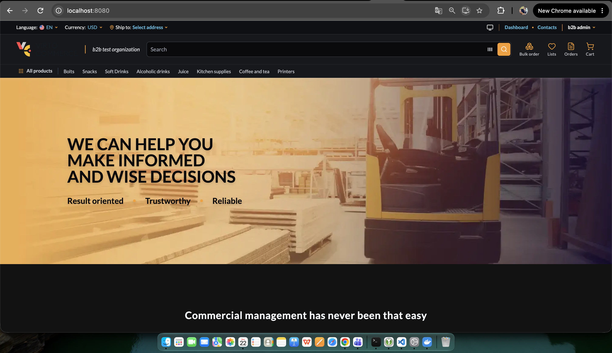
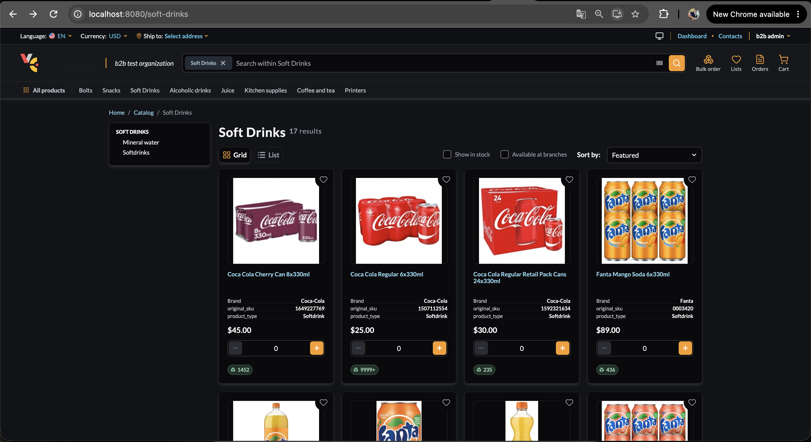
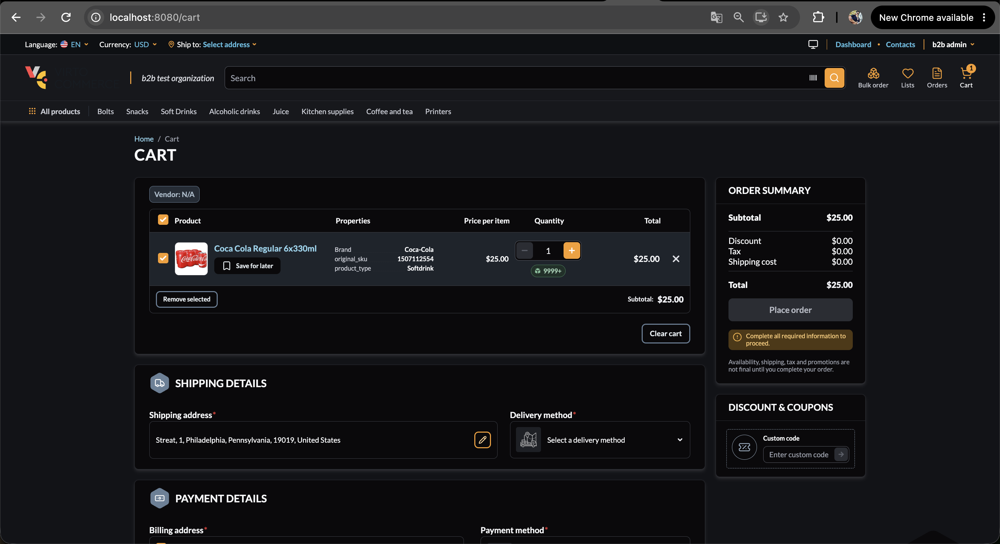
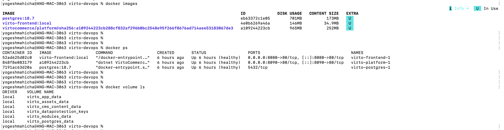

# Virto DevOps Project

## Project Overview

This repository contains the DevOps setup for the Virto Commerce application, including frontend and backend configuration using Docker and shell scripting.

## Project Screenshots

### Frontend

#### Home Page


#### Catalog Page


#### Product Page


#### Checkout Page


### Backend

#### Admin Panel


### System


## Repository Structure

```text
virto-devops/
├── docker/
├── docs/
│   └── images/
│       ├── frontend.png
│       ├── catalog.png
│       ├── product.png
│       ├── checkout.png
│       ├── backend.png
│       └── system.png
├── scripts/
├── .env.example
├── .gitignore
└── README.md
```

## Technologies & Tools

- Docker
- Docker Compose
- Git & GitHub
- Shell Scripting
- Environment Configuration
- Virto Commerce

---

## Installation & Setup Guide

### Step 1: Clone the Repository

Clone the repository and navigate to the project directory.

```bash
git clone https://github.com/yogeshmahicha1999/virto-devops.git

cd ~/virto-devops
```

### Step 2: Start the Application

Run the following commands to clean up existing containers and start the complete application setup.

```bash
cd ~/virto-devops

docker compose --env-file .env -f docker/docker-compose.yml down -v

./scripts/setup.sh
```

**Note:** Wait approximately 10–15 minutes for all containers and services to initialize successfully.

Make sure all containers are running before proceeding to the next step.

### Step 3: Access the Admin Panel / Backend

Once all containers are running, open the following URL in your browser:

**Admin Panel:**

http://localhost:8090/

Log in to the admin panel and import the sample data.

### Step 4: Configure B2B Admin User and Password

After importing the sample data, execute the following commands to configure the B2B admin user's password and verify frontend authentication.

```bash
cd ~/virto-devops
PW='Welcome@1'
for p in 'Welcome@1' 'store'; do
  T=$(curl -s -X POST http://localhost:8090/connect/token --data-urlencode grant_type=password --data-urlencode username=admin --data-urlencode "password=$p" | grep -o '"access_token": *"[^"]*"' | cut -d'"' -f4)
  [ -n "$T" ] && echo "admin login OK (password: $p)" && break
done
curl -s -X POST http://localhost:8090/api/platform/security/users/b2badmin/resetpassword -H "Authorization: Bearer $T" -H "Content-Type: application/json" -d "{\"newPassword\":\"$PW\",\"forcePasswordChangeOnNextSignIn\":false}"
echo
curl -s -X POST http://localhost:8080/connect/token --data-urlencode grant_type=password --data-urlencode scope=offline_access --data-urlencode storeId=B2B-store --data-urlencode username=b2badmin@test.com --data-urlencode "password=$PW" | grep -q access_token && echo "frontend login test OK" || echo "frontend login test FAILED"

```

### Step 5: B2B User Credentials

After successfully executing the above commands, the B2B admin user credentials will be:

| Field | Value |
|---|---|
| Username | b2badmin@test.com |
| Password | Welcome@1 |

The password is configured through the `PW` variable in the command above. You can change it to your preferred password before executing the commands.

**Important:** Use a strong password for production environments and never commit credentials, tokens, or secrets to GitHub.

---

## Environment Configuration

1. Copy `.env.example` to `.env`.
2. Configure the required environment variables.
3. Ensure all required Docker services are configured correctly.
4. Keep `.env` excluded from Git to protect sensitive information.

## Author

Yogesh Mahicha
