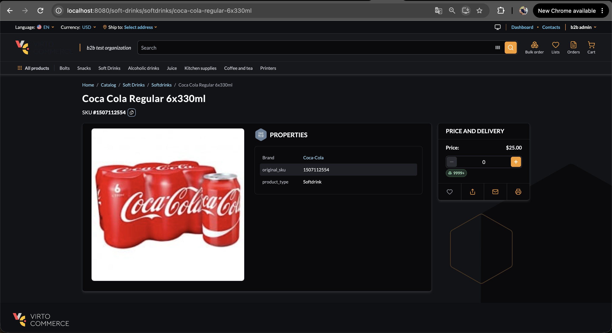
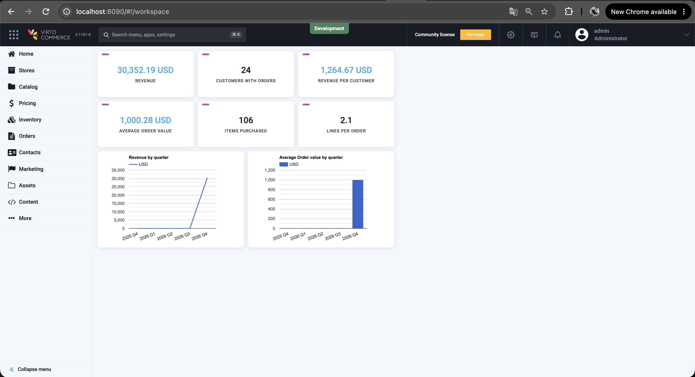

# Virto DevOps Project

## Project Overview

This repository contains the DevOps setup for the Virto Commerce application, including frontend and backend configuration.

## Project Screenshots

### Frontend

#### Home Page


#### Catalog Page


#### Product Page


#### CheckOut Page


### Backend

#### AdminPanel Page



## Repository Structure

```text
virto-devops/
├── docker/
├── docs/
│   └── images/
│       ├── frontend.png
│       └── backend.png
├── scripts/
├── .env.example
├── .gitignore
└── README.md
```

## Technologies & Tools

- Docker
- Git & GitHub
- Shell Scripting
- Environment Configuration

## Environment Configuration

1. Clone the repository.
2. Copy `.env.example` to `.env`.
3. Configure the required environment variables.
4. Follow the Docker configuration to set up the application.

